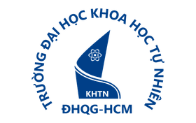
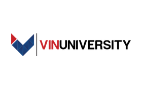
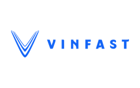

<!-- Edit scripts/console-profile.json and run python scripts/render-console.py to rebuild the banner. -->
<h1>
  <picture>
    <source media="(max-width: 1000px) and (prefers-reduced-motion: reduce)" srcset="./assets/terminal-profile-compact-still.svg">
    <source media="(max-width: 1000px)" srcset="./assets/terminal-profile-compact.svg">
    <source media="(prefers-reduced-motion: reduce)" srcset="./assets/terminal-profile-still.svg">
    
  </picture>
</h1>

I work on applied machine learning, with projects in Vietnamese text-to-SQL and 3D annotation quality for ADAS.

[Projects](#featured-projects) · [Journey](#my-journey) · [LinkedIn](https://www.linkedin.com/in/quangxuan-nguyen/)

## Featured projects

### Vietnamese Text-to-SQL chatbot

I built the RAG and SQL generation layer and designed the multi-agent chatbot for a two-person graduation thesis. On 100 Vietnamese test queries, our hybrid retrieval approach achieved **91% execution accuracy** and **88% result accuracy**, up from 80% and 75% for the baseline.

`Python` · `LangChain` · `PostgreSQL` · `pgvector` · `Streamlit`

### MentorPrep

I proposed and built the frontend for a team dashboard that pulls CVAT jobs and GitHub activity into one place so annotators can review progress, quality scores, and difficult cases before mentor sessions.

[Project showcase](https://nexus-workspace-demo.vercel.app/showcase)

## My journey

<table>
  <tr>
    <td align="center" valign="top" width="33%">
       
      <strong>HCMUS</strong>
      
B.S. in <abbr title="Mathematical Methods in Computer Science">Math Methods for CS</abbr> <em>Sep 2022 – Jul 2026</em>

    </td>
    <td align="center" valign="top" width="33%">
       
      <strong>VinUni</strong>
      
Vingroup Applied AI Talent Program, Cohort 4 <em>Sep 2026</em>

    </td>
    <td align="center" valign="top" width="33%">
       
      <strong>VinFast</strong>
      
ADAS <abbr title="on-the-job training">OJT</abbr> in 3D labels and data quality <em>Oct 2026 – Present</em>

    </td>
  </tr>
</table>

## More machine learning work

- **Offline signature verification** · Built the prediction pipeline and implemented Otsu thresholding. The team's ResNet50 and SVM model reached 93% accuracy on 2,640 CEDAR signatures.
- **Diabetes risk modeling** · Led data preprocessing for a retrospective machine learning project using BRFSS 2015 survey data. Logistic regression achieved an ROC AUC of 0.846 on the project evaluation.

## Tools I work with

- **AI and ML** · Python, LangChain, PyTorch, scikit-learn, OpenCV, R
- **Data and retrieval** · SQL, PostgreSQL, pgvector, BM25, Kafka, Spark
- **Applications and tooling** · CVAT, Docker, React, TypeScript, Streamlit
