<h1>
  <picture>
    <source media="(prefers-reduced-motion: reduce)" srcset="./assets/profile-hello-world-still.png">
    
  </picture>
</h1>

Hey, I'm Quang 👋 I like building tools that turn questions into SQL or catch bad 3D labels before they ship.

[LinkedIn](https://www.linkedin.com/in/quangxuan-nguyen/)

## My journey

<picture>
  <source media="(min-width: 1180px)" srcset="./assets/journey-beach.png 2x">
  
</picture>

<table>
  <tr>
    <td align="center"></td>
    <td><strong>University of Science, VNU-HCM</strong> B.S. in Mathematical Methods in Computer Science Sep 2022 – Jul 2026</td>
  </tr>
  <tr>
    <td align="center"></td>
    <td><strong>VinUniversity</strong> Training in the Vingroup Applied AI Talent Program, Cohort 4 Sep 2026</td>
  </tr>
  <tr>
    <td align="center"></td>
    <td><strong>VinFast</strong> ADAS on-the-job training in 3D annotation and data quality Oct 2026 – Present</td>
  </tr>
</table>

## Featured projects

### Vietnamese Text-to-SQL chatbot

I built the RAG and SQL generation layer and designed the multi-agent chatbot for a two-person graduation thesis. On 100 Vietnamese test queries, our hybrid retrieval approach achieved **91% execution accuracy** and **88% result accuracy**, up from 80% and 75% for the baseline.

`Python` · `LangChain` · `PostgreSQL` · `pgvector` · `Streamlit`

## More machine learning work

- **Offline signature verification** · Built the prediction pipeline and implemented Otsu thresholding. The team's ResNet50 and SVM model reached 93% accuracy on 2,640 CEDAR signatures.
- **Diabetes risk modeling** · Led data preprocessing for a retrospective machine learning project using BRFSS 2015 survey data. Logistic regression achieved an ROC AUC of 0.846 on the project evaluation.

## Tools I work with

- **AI and ML** · Python, LangChain, PyTorch, scikit-learn, OpenCV, R
- **Data and retrieval** · SQL, PostgreSQL, pgvector, BM25, Kafka, Spark
- **Applications and tooling** · CVAT, Docker, React, TypeScript, Streamlit
