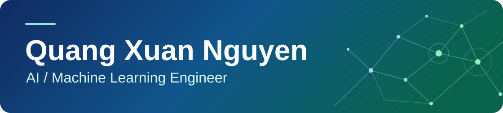

<h1></h1>

I build LLM applications and data quality tools. I'm a Mathematical Methods in Computer Science graduate from the University of Science, VNUHCM, and I'm working on ADAS annotation pipelines and 3D data quality during on-the-job training at VinFast through the Vingroup Applied AI Talent Program.

[LinkedIn](https://www.linkedin.com/in/quangxuan-nguyen/)

## Featured projects

### Vietnamese Text-to-SQL chatbot

I built the RAG and SQL generation layer and designed the multi-agent chatbot for a two-person graduation thesis. On 100 Vietnamese test queries, our hybrid retrieval approach achieved **91% execution accuracy** and **88% result accuracy**, up from 80% and 75% for the baseline.

`Python` · `LangChain` · `PostgreSQL` · `pgvector` · `Streamlit`

## More machine learning work

- **Offline signature verification** · Built the prediction pipeline and implemented Otsu thresholding. The team's ResNet50 and SVM model reached 93% accuracy on 2,640 CEDAR signatures.
- **Diabetes risk modeling** · Led data preprocessing for a retrospective machine learning project using BRFSS 2015 survey data. Logistic regression achieved an ROC AUC of 0.846 on the project evaluation.

## Tools I work with

- **AI and ML** · Python, LangChain, PyTorch, scikit-learn, OpenCV, R
- **Data and retrieval** · SQL, PostgreSQL, pgvector, BM25, Kafka, Spark
- **Applications and tooling** · CVAT, Docker, React, TypeScript, Streamlit
